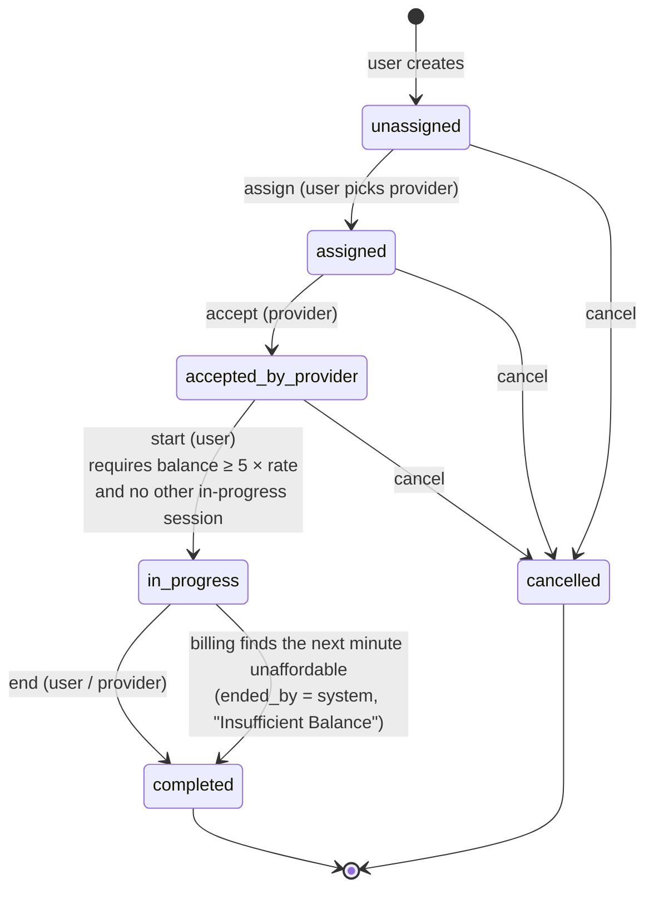
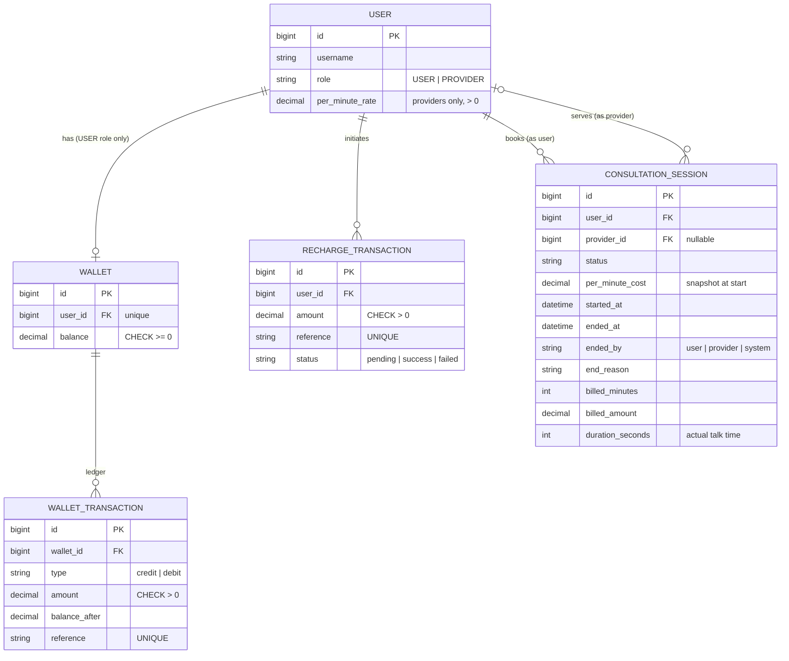

# Design notes

## Session state diagram

The whole lifecycle is declared as one table in [consultations/state_machine.py](../consultations/state_machine.py). Any action not listed for the current state is rejected with `400 invalid_transition`.

## ER diagram

Partial unique index: `UNIQUE (user_id) WHERE status = 'in_progress'`.

## Implementation decisions

### 1. Business rules live in a service layer, not in views

All the rules are in three service modules:

- `wallet/services.py`
- `consultations/services.py`
- `consultations/billing.py`

Views only parse input and call one service function. Services raise `DomainError` subclasses, each carrying an error code and HTTP status. One DRF exception handler turns them into `{"error", "detail"}` responses. This keeps the rules testable without HTTP, and keeps error responses consistent.

### 2. Every money movement is locked, recorded and idempotent

- **One entry point:** wallet balances change only through `credit()` and `debit()`. Each runs in a transaction, locks the wallet row (`SELECT … FOR UPDATE`) and writes a ledger entry.
- **Unique ledger references:** every ledger entry has a unique business `reference`:
  - `recharge:<ref>`
  - `session:<id>:minute:<n>`

  So even if the application logic were wrong, the database would refuse to apply the same credit or debit twice.
- **No negative balances, enforced twice:**
  1. `debit()` raises `InsufficientBalance` instead of overdrawing.
  2. A `CHECK (balance >= 0)` constraint in the database rejects any write that would go negative.
- **Decimal money:** amounts use `DecimalField`, never floats.

### 3. Recharge callback idempotency

The callback locks the `RechargeTransaction` row before reading its status. Outcomes:

- **Pending:** the callback is applied. On `success` the wallet is credited, and the status update happens in the same transaction.
- **Already final with the same status:** a duplicate delivery. It returns `200 {"applied": false}` and changes nothing. Returning 200 stops the gateway from retrying.
- **Already final with a different status** (failed, then success): `409`. This contradicts the earlier callback and needs a human to look at it.

Because of the lock, two identical callbacks arriving at the same moment are processed one after the other. [tests/test_concurrency.py](../tests/test_concurrency.py) checks this with 8 parallel threads.

The webhook is authenticated with a shared secret header instead of a user JWT, because a gateway isn't a logged-in user.

### 4. Billing model: in arrears, whole minutes, look-ahead stop

- **When a minute is charged:** minute *N* is charged once *N* full minutes have passed since `started_at`. A trailing partial minute is **not** charged. This is the most consumer-friendly reading of "per minute", and it keeps 3 minutes = 150 exact.
- **Catching up:** a billing run charges every full minute not yet charged, one debit per minute. A late run catches up and never charges a minute twice.
- **Stopping before unpaid time:** after charging, the wallet must still cover the **next** minute. If it can't, or if a charge fails during a catch-up, the system completes the session with `ended_by = system` and `end_reason = "Insufficient Balance"`. This matches the spec's example: balance 40, cost 50, so the session ends and the wallet stays at 40.
- **Recorded time:** both the billable time (`billed_minutes`, `billed_amount`) and the actual talk time (`duration_seconds`) are saved.
- **Ending a session:** `end` runs a final billing pass up to the moment it ends, so the user can't skip the last full minutes by ending early.
- **Why the 5× start buffer matters:** a session only starts with at least 5 minutes of funds. Together with the look-ahead stop, the user can't run up unpaid time as long as billing runs at least once a minute.

**How the same minute is never charged twice:**

1. The session row is locked for the whole billing run, so runs for one session happen one at a time.
2. Only minutes after `billed_minutes` are charged, and the counter is saved in the same transaction as the debits.
3. The unique ledger reference `session:<id>:minute:<n>` blocks a duplicate in the database.

### 5. The per-minute cost is copied when the session starts

Each provider has a `per_minute_rate`. When a session starts, that rate is copied into `session.per_minute_cost` and never changes afterwards. If the provider changes their rate mid-session, running sessions are unaffected, but sessions that haven't started yet use the new rate.

### 6. One in-progress session per user

This rule is enforced twice:

- **In the application:** `start` checks for an existing in-progress session while it holds a lock on the user's wallet. Two simultaneous starts by the same user therefore run one after the other.
- **In the database:** a partial unique index guarantees the rule even if the application check were bypassed.

### 7. Lock ordering

Locks are always taken in this order: session, then wallet.

- Recharges lock only the wallet.
- Session operations lock the session first, then the wallet.

So two operations can never each hold the lock the other is waiting for. That rules out deadlocks.

### 8. Roles and permissions

- **Who can call an endpoint:** `IsUserRole` and `IsProviderRole` decide this.
- **Who can perform an action:** checked inside the services. Only the assigned provider can accept, only the session's user can start, and either side can end or cancel.
- **What a caller can see:** a caller who isn't part of a session gets `404`, so session IDs don't leak.
- **Wrong role:** a caller who is part of the session but in the wrong role gets `403`.

### 9. Synchronous billing

As the assignment allows, billing runs synchronously: through `POST /api/sessions/{id}/bill/`, or the `bill_active_sessions` management command (cron or `--loop`). Each session is billed in its own transaction, so a failure on one session doesn't affect the others.

In production, this command would become a scheduled Celery or RQ task. The billing function wouldn't change.

## Known limitations / out of scope

- **Late billing runs can leave a short unpaid period.** If billing runs late *and* the wallet can't cover everything owed, the time between the last affordable minute and the late run goes unpaid. The 5× start buffer and the look-ahead stop make this rare.
- **Recharge callbacks aren't cryptographically signed.** They use a shared secret only. A real gateway would sign each callback with an HMAC and include a timestamp.
- **No refunds, provider payouts, multi-currency support or admin workflows.**
